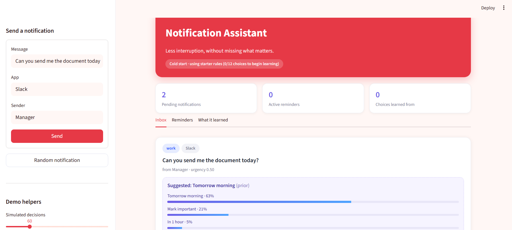
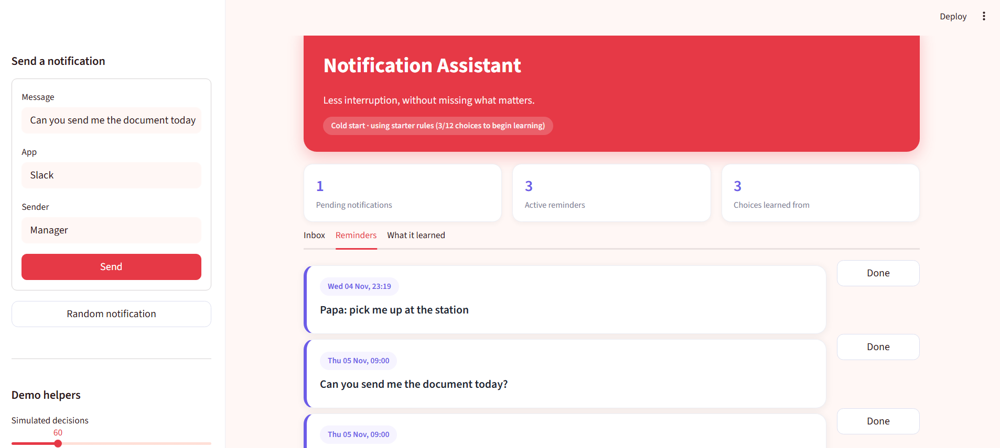
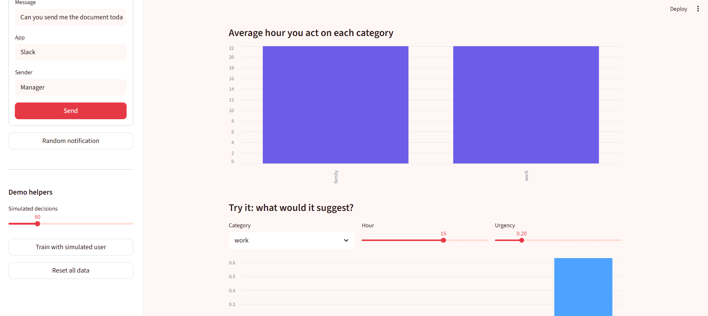

# Smart Notification Assistant

**Less interruption, without missing what matters.**

An AI-powered notification management system that helps users organize notifications based on their importance, urgency, and personal preferences.

The application analyses notification messages, recommends suitable actions, and learns from user feedback to provide personalized suggestions over time.

## Project Preview
*Dashboard preview of the Smart Notification Assistant.*




## Overview

People receive numerous notifications every day from different applications. Managing all of them can become overwhelming, and important notifications can easily get missed.

The Smart Notification Assistant aims to solve this problem by analysing notification content, identifying its category and urgency, and recommending appropriate actions.

It also learns from user interactions to make future recommendations more personalized.

## Features

- **Notification Classification:** Identifies categories such as Work, Family, Shopping and Education.
- **Urgency Detection:** Analyses notification content to estimate urgency.
- **Smart Recommendations:** Suggests actions such as 1 Hour, Tonight, Tomorrow, Important or Ignore.
- **Personalized Learning:** Learns from user feedback to improve future recommendations.
- **Let AI Decide:** Automatically selects the highest-ranked recommendation.
- **Reminder Management:** Creates reminders for notifications that need attention later.
- **Analytics Dashboard:** Displays notification statistics, user choices and learned preferences.

## How It Works

1. **Notification Input:** The user submits a notification along with its source.
2. **Text Analysis:** The system analyses the notification and identifies its category and urgency.
3. **Recommendation:** The system suggests an appropriate action.
4. **User Interaction:** The user selects an action or allows the AI to decide.
5. **Personalized Learning:** Eligible user choices are stored and used to improve future recommendations.

## Example Scenarios

| Notification | Category | Possible Action |
|---|---|---|
| Submit the project document today | Work | Tonight |
| Mom asks you to call her | Family | 1 Hour |
| Shopping sale ends tonight | Shopping | Ignore |

Recommendations can evolve as the system learns individual user preferences.

## Technologies Used

- Python
- Streamlit
- Machine Learning and Recommendation Logic
- Data Processing and Analytics

## Installation and Setup

### Prerequisites

- Python 3.10+
- pip

### 1. Clone the repository

```bash
git clone YOUR_REPOSITORY_URL
```

### 2. Navigate to the project directory

```bash
cd notif_assistant
```

### 3. Create a virtual environment

```bash
python -m venv venv
```

### 4. Activate the environment

Windows:

```powershell
venv\Scripts\activate
```

### 5. Install dependencies

```bash
pip install -r requirements.txt
```

### 6. Run the application

```bash
python -m streamlit run app.py
```

Open the local URL displayed in your terminal to access the application.

## Dashboard Sections

- **Inbox:** View and manage pending notifications.
- **Reminders:** View active reminders.
- **What It Learned:** Explore learned user preferences.
- **Analytics:** Monitor notification activity and feedback.

## Future Improvements

- Real-time mobile notification integration.
- Support for additional notification platforms.
- Advanced natural language processing.
- Improved personalization algorithms.
- Mobile application integration.

## Author

**Sudeshna Sarkar**

B.Tech, Computer Science and Engineering

[GitHub Profile](https://github.com/sudzzzzz)

---

*An intelligent approach to managing everyday notifications.*
